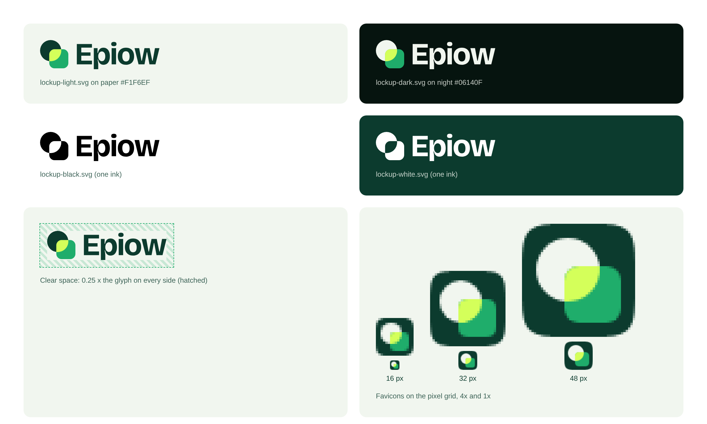

# Epiow logo: master files and usage sheet

This folder is the source of truth for the Epiow mark ("Overlap",
decided 2026-11-17), the "Epiow" wordmark and their lockups. It is the brand
home for Epiow, Epiow Legacy and the Epiow chatbot. Every file in
`current/`, `icons/` and `sheet/` is written by one generator from one
construction, so any file can be rebuilt. Do not edit an output by hand:
change the spec and run the generator.

```bash
node scripts/build-brand.mjs          # needs Node 20+ and Chromium (CHROMIUM=/path to override)
node scripts/build-brand.mjs --check  # SVGs match the spec, every file matches SHA256SUMS (no browser)
```

- Geometry: [`construction/epiow-logo.spec.json`](construction/epiow-logo.spec.json)
- Colours: [`../tokens/brand.tokens.json`](../tokens/brand.tokens.json) (`palette`, `logo.colours`)
- Construction drawing: [`construction/epiow-mark-construction.svg`](construction/epiow-mark-construction.svg)
- Hashes of every output: [`SHA256SUMS`](SHA256SUMS) (`sha256sum -c logo/SHA256SUMS` from the repository root)



## Files

| Need | File |
|---|---|
| Website header, documents, slides (light ground) | `current/lockup-light.svg` |
| Same, on a dark ground | `current/lockup-dark.svg` |
| The mark alone (app tile) | `current/mark.svg` |
| Full-bleed square for OS masks | `current/mark-maskable.svg` |
| The mark without its tile (headers, documents, dense UI) | `current/glyph-on-light.svg`, `current/glyph-on-dark.svg` |
| The word alone | `current/wordmark-light.svg`, `current/wordmark-dark.svg` |
| One ink only (print, engraving, stamps, photos) | `current/{mark,wordmark,lockup}-black.svg`, `-white.svg` |
| Browser tab | `current/favicon.svg`, `icons/favicon.ico` (16, 32, 48), `icons/favicon-{16,32,48}.png` |
| iOS home screen | `icons/apple-touch-icon-180.png` |
| PWA manifest | `icons/icon-{192,512}.png` (purpose `any`), `icons/icon-maskable-{192,512}.png` (purpose `maskable`) |
| Store listing, GitHub avatar | `icons/icon-1024.png`, `icons/icon-512.png` |

Suggested HTML:

```html
<link rel="icon" href="/favicon.ico" sizes="16x16 32x32 48x48">
<link rel="icon" href="/favicon.svg" type="image/svg+xml">
<link rel="apple-touch-icon" href="/apple-touch-icon-180.png">
<meta name="theme-color" content="#F7FAF5" media="(prefers-color-scheme: light)">
<meta name="theme-color" content="#06140F" media="(prefers-color-scheme: dark)">
```

The PWA manifest uses `theme_color` `#0C3B2E` and `background_color` `#F1F6EF`.

## Construction

- **Grid:** 64 units.
- **Glyph:** a circle (the people) and a rounded square (the work) overlap;
  the shared area is the lens, where the two meet. Circle centre (27, 27),
  r = 15. Square from (25, 25), side 27, corner radius 7.5. The glyph
  occupies the 40-unit box from (12, 12), inside the 80% maskable safe zone.
- **Colours on light grounds:** circle forest `#0C3B2E`, square green
  `#1FAD6B`, lens lime `#D4FF5A`. **On dark grounds and on the tile** the
  circle is paper `#F1F6EF`; the square and the lens do not change.
- **Tile:** the superellipse |x|^5 + |y|^5 = 1 spanning the whole box, the
  same shape as every Epiow app icon. Forest `#0C3B2E`. The tile is the app
  icon and the favicon; headers and documents use the glyph without a tile.
- **Wordmark:** "Epiow" in Bricolage Grotesque Bold (wght 700, opsz 48, SIL
  Open Font License 1.1), tracked -30/1000 and outlined. Letters are forest
  on light grounds and paper on dark grounds.
- **Lockup:** glyph + wordmark; wordmark cap height = 0.72 x the glyph;
  gap = 0.3 x the glyph; the cap-height band is centred on the glyph.
- **One ink:** the circle and the square take the ink and the lens is cut
  out, so the paper or photo behind shows through it. The wordmark takes the
  same ink.
- No gradients, glows or shadows anywhere in the logo.

## Small sizes

`favicon.svg` and the 16, 32 and 48 px icons use a larger glyph (`small` in
the spec): it fills 75% of the tile, and the square's edges and the circle's
extents land on whole pixels at 16, 32 and 48 px (at 16 px: circle 2 to 11,
square 6 to 14). From 180 px up, every file uses the standard glyph. The
tile edge and the circle stay anti-aliased at every size.

## Clear space and minimum size

- **Clear space:** 0.25 x the glyph's height on every side of the mark or the
  lockup (12 px around a 48 px lockup). No text, edge or other logo inside it.
- **Minimum size:** the mark 16 px on screen (use `favicon-16.png` or the
  ICO below 24 px, not the vector); the lockup 24 px tall on screen, 6 mm
  tall in print; the wordmark alone 12 px cap height.
- The SVG viewBoxes are tight to the artwork; add clear space where the logo
  is placed, not inside the file.

## Contrast

| Pair | Ratio |
|---|---|
| Paper circle on the forest tile | 11.4:1 |
| Lime lens on the forest tile | 10.9:1 |
| Green square on the forest tile | 4.3:1 |
| Forest letters on paper | 11.4:1 |
| Paper letters on night | 17.2:1 |
| Green square on night | 6.5:1 |
| Green square on paper | 2.6:1 (the forest circle and the lens carry the mark on light grounds) |
| Lime lens on paper | 1.1:1 (the lens always sits inside the circle and the square, never alone on a light ground) |
| Forest tile on night | 1.5:1 (the tile merges with a night ground; the glyph carries the mark) |

## Do

- Use these files as they are, scaled evenly.
- Use `lockup-light` on paper, white and light photos; `lockup-dark` on night
  and dark photos.
- Use the one-ink versions on busy photos, colour grounds, and anywhere only
  one ink is available.
- Write the name in running text as "Epiow"; use the logo files, not typed
  text, wherever the logo is meant.

## Don't

- Stretch, squash, rotate, skew or outline the logo.
- Recolour any of the three shapes, add a second lime element, or put the
  colour mark on a lime or green ground (use a one-ink version there).
- Add gradients, glows, bevels or shadows.
- Swap which shape is in front, separate the two shapes, or outline them.
- Redraw the tile as a rounded rectangle: it is the superellipse.
- Retype "Epiow" in a font, or change the space between mark and wordmark:
  use a lockup file.
- Write "EPIOW" or "epiow" as the logo.

## Provenance

The mark was drawn by hand as geometry (no trace, no AI raster) on
2026-11-17 and chosen by Kyle from seven candidate directions the same day.
This repository is its first home; no surface shipped it before.

| Input | Where it came from |
|---|---|
| Circle, square, lens, lockup ratios | `construction/epiow-logo.spec.json` (this change) |
| Wordmark outlines | Bricolage Grotesque variable font from `google/fonts` (`ofl/bricolagegrotesque`), instanced at wght 700, opsz 48, wdth 100 with fontTools and tracked -30/1000 |
| Tile (superellipse, 160 segments, 2 decimals) | unchanged: `EpiowAI/epiow` `apps/web/src/lib/design/app-icon/squircle.ts` |
| Colours | `../tokens/brand.tokens.json` 5.0.0 |

Renderer: Chromium 156.0.8078.79 headless (`scripts/build-brand.mjs`).
Another Chromium version may change edge pixels of the PNGs; rebuild, look
at the result, and commit the new `SHA256SUMS`.

The previous identity ("Bracket and signal", 2026-09-23) is kept whole in
`archive/bracket-and-signal-2026-09/`: masters, icons, spec, usage sheet and
tokens 3.0.0. Earlier explorations stay as archive: `options*/`, `reverse/`,
`archive/e-orbit-2026-07/`.

## Trademark

Unregistered. See [`../docs/trademarks.md`](../docs/trademarks.md).
